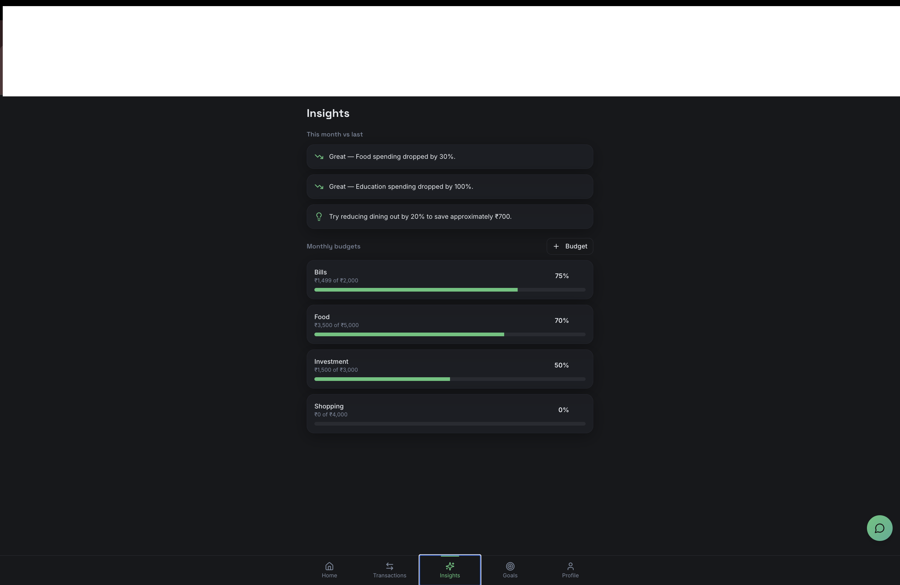

<h1 align="center">P₹ PayFi</h1>
<p align="center"><b>Your money, decoded.</b><br>A personal finance app for students who want to know where their money actually goes.</p>

<p align="center">
  <a href="https://payfi-finance.vercel.app"><b>Live demo</b></a> ·
  <a href="https://www.linkedin.com/in/pooja-dahiya-a04012297/">LinkedIn</a> ·
  <a href="https://pooja-portfoliooo.netlify.app/">Portfolio</a>
</p>


## Why I built this

I'm a student, and by the end of every month I had no idea where my money went. The expense apps I tried were just long lists of transactions. I wanted something that warns me before I overspend and keeps my savings goals in front of me, so I built it.

PayFi is also the project where I went beyond frontend work: real authentication, a PostgreSQL database, an AI assistant that reads your own numbers, and a production deployment.

## What it does

- **Dashboard:** your balance, income, expenses and savings at a glance, a six-month income vs. expense chart, this month's spending by category, and recent transactions. One tap hides your balance if someone is looking over your shoulder.
- **Transactions:** add income and expenses with a category, and filter by type or category.
- **Budgets:** set a monthly limit for each category. The bars fill as you spend, and PayFi warns you when you go over.
- **Savings goals:** set a target and add money towards it as you go.
- **Financial health score:** one number out of 100, built from your savings rate, budget compliance, goal completion and consistency.
- **PayFi AI:** a chat assistant that answers questions using your own income, spending, budgets and goals instead of generic advice.
- **Accounts:** sign in with email or Google, and every account has its own data.
- **Light and dark mode.**

## Screenshots

| Dashboard | Transactions | Budgets |
|---|---|---|
|  |  |  |

| Goals | PayFi AI |
|---|---|
|  |  |

## How the AI works

PayFi AI runs in a Supabase Edge Function (`supabase/functions/payfi-chat`), so the Gemini API key stays on the server and never reaches the browser.

1. The function checks the signed-in user's token and confirms the chat thread belongs to them.
2. It loads this month's transactions, your budgets and your goals, and turns them into a short summary.
3. That summary and the chat history go to Google Gemini, with instructions to be concise, use ₹, and never make up numbers.
4. The reply is saved to your chat thread.

A note on privacy: when you ask the AI a question, a summary of your current month is sent to Google's Gemini API to generate the answer.

## Tech stack

| Layer | Technology |
|---|---|
| Frontend | React 18, TypeScript, Vite |
| Styling | Tailwind CSS, shadcn/ui, Framer Motion |
| Data and forms | TanStack React Query, React Hook Form, Zod |
| Charts | Recharts |
| Backend and database | Supabase (PostgreSQL, Edge Functions) |
| Auth | Supabase Auth (email and Google) |
| AI | Google Gemini, called from a Supabase Edge Function |
| Deployment | Vercel |

## Getting it live took a while

PayFi worked locally for months before I could deploy it. Supabase environment variables kept breaking the production build, and I couldn't work out why. I eventually got the Supabase keys, the GitHub repo and Vercel working together, and it's live now. After that I redesigned the dashboard and profile pages.

## What I learned

- Designing an app where every user only sees their own data.
- Calling an AI model from a server-side function so the API key is never exposed.
- How environment variables behave between local development and a production build.

## Run it yourself

```bash
git clone https://github.com/poojadahiya22/payfi.git
cd payfi
npm install
```

Create a `.env` file with your own Supabase project keys:

```
VITE_SUPABASE_URL=your_supabase_url
VITE_SUPABASE_ANON_KEY=your_supabase_anon_key
```

Set up the database and the AI function (needs the [Supabase CLI](https://supabase.com/docs/guides/cli) and a Gemini API key):

```bash
supabase link --project-ref your_project_ref
supabase db push                                   # applies supabase/migrations
supabase secrets set GEMINI_API_KEY=your_gemini_key
supabase functions deploy payfi-chat
```

Then start the app:

```bash
npm run dev
```

## Roadmap

- [ ] Recurring transactions
- [ ] Subscription reminders
- [ ] Mobile app

## About me

Built by **Pooja Dahiya**, a B.Tech CSE student at Graphic Era Hill University (2023–2027) who likes building full-stack products from start to finish. I'm looking for Software Engineer and Full-Stack Developer roles. [Let's connect on LinkedIn](https://www.linkedin.com/in/pooja-dahiya-a04012297/).

Released under the [MIT License](LICENSE).
